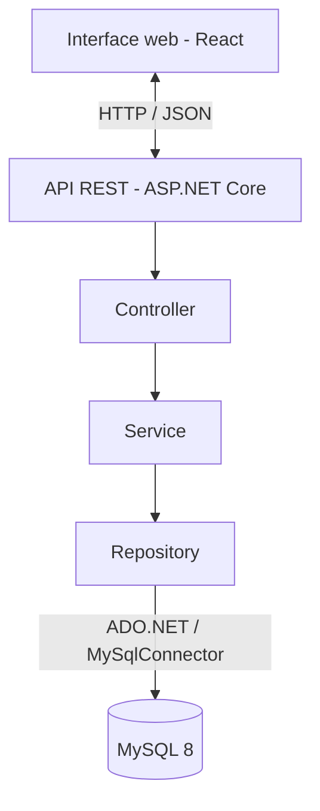

  <h1>🕹️ RetroGames</h1>
  
<strong>A nostalgia dos clássicos. A praticidade de uma loja digital.</strong>

  
Uma loja virtual dedicada à compra de jogos retrô usados, reunindo catálogo, administração e uma experiência de compra completa em um só lugar.

  

    
    
    
    
    
  

---

## ✦ Sobre o projeto

O **RetroGames** é uma loja virtual de jogos retrô usados, criada para aproximar colecionadores e entusiastas dos videogames clássicos de títulos que marcaram gerações.

A plataforma oferece uma experiência de navegação simples e organizada. Visitantes exploram o catálogo, pesquisam jogos e consultam seus detalhes; clientes criam uma conta, montam um carrinho e acompanham seus pedidos; administradores gerenciam o catálogo e as operações da loja.

O sistema utiliza uma arquitetura cliente-servidor, com interface em React, API REST em ASP.NET Core e banco de dados relacional MySQL.

---

## 🎮 Funcionalidades

<table>
  <tr>
    <td width="50%" valign="top">
      <h3>🕹️ Catálogo</h3>
      
Explore os jogos disponíveis e encontre seus clássicos favoritos.

      <ul>
        <li>Busca por nome.</li>
        <li>Filtros por plataforma e gênero.</li>
        <li>Listagem paginada.</li>
        <li>Detalhes, condição, preço e disponibilidade de cada jogo.</li>
      </ul>
    </td>
    <td width="50%" valign="top">
      <h3>👤 Conta e autenticação</h3>
      
Uma experiência adequada a cada perfil de acesso.

      <ul>
        <li>Cadastro de clientes.</li>
        <li>Login e encerramento de sessão.</li>
        <li>Identificação do usuário autenticado.</li>
        <li>Menus e opções conforme o perfil.</li>
      </ul>
    </td>
  </tr>
  <tr>
    <td width="50%" valign="top">
      <h3>🛒 Carrinho e compras</h3>
      
Organize os itens e conclua compras com segurança.

      <ul>
        <li>Adicionar, remover e alterar quantidades.</li>
        <li>Resumo de valores e total da compra.</li>
        <li>Validação de preço e estoque.</li>
        <li>Finalização e registro do pedido.</li>
        <li>Histórico em Meus pedidos.</li>
      </ul>
    </td>
    <td width="50%" valign="top">
      <h3>⚙️ Administração</h3>
      
Ferramentas para gerenciar o catálogo e as vendas.

      <ul>
        <li>Cadastro e edição de jogos e plataformas.</li>
        <li>Associação de jogos a gêneros.</li>
        <li>Desativação lógica de jogos.</li>
        <li>Manutenção de gêneros.</li>
        <li>Consulta e gestão de pedidos.</li>
      </ul>
    </td>
  </tr>
</table>

---

### 🕹️ Catálogo de jogos

O catálogo apresenta os jogos disponíveis para compra e oferece ferramentas para encontrar títulos com facilidade.

- Busca textual por nome.
- Filtros por plataforma e gênero.
- Listagem paginada.
- Página de detalhes com informações do jogo, plataforma, condição, gêneros, preço e disponibilidade.

### 👤 Conta e autenticação

O sistema diferencia visitantes, clientes e administradores, oferecendo opções adequadas a cada perfil.

- Cadastro de clientes com nome, e-mail e senha, criando a conta com perfil **Cliente**.
- Login, encerramento de sessão e identificação do perfil autenticado.
- Menus e opções de navegação conforme as permissões do usuário.

### 🛒 Carrinho e compras

O cliente pode organizar os jogos escolhidos e concluir a compra com validação das informações no servidor.

- Adição de jogos ao carrinho a partir da página de detalhes, sem permitir produtos esgotados.
- Alteração de quantidades de 1 a 10 unidades e remoção de itens.
- Visualização dos valores unitários e do total da compra.
- Validação de disponibilidade e estoque no momento da finalização.
- Cálculo dos valores utilizando os preços registrados no banco de dados.
- Registro do pedido, de seus itens e atualização do estoque em uma única transação.
- Consulta do histórico em **Meus pedidos**, com situação, total e itens de cada pedido.

### ⚙️ Administração

As ferramentas administrativas permitem manter o catálogo e acompanhar as operações da loja.

- Cadastro, consulta, edição e exclusão de plataformas, respeitando os vínculos existentes.
- Cadastro e edição de jogos, com associação a gêneros, plataforma e condição de conservação.
- Desativação lógica de jogos, preservando o histórico dos registros.
- Consulta administrativa de jogos ativos e inativos.
- Cadastro, edição e exclusão de gêneros, respeitando os vínculos com jogos.
- Consulta e acompanhamento dos pedidos realizados.
- Filtro de pedidos por situação e atualização de seu status.
- Visualização dos detalhes de um pedido, respeitando as permissões de cada perfil.

---

## 👤 Perfis de acesso

Cada tipo de usuário possui permissões adequadas às suas necessidades dentro da loja.

| Perfil | Permissões |
|---|---|
| **Visitante** | Navegar pelo catálogo, pesquisar, filtrar jogos, consultar detalhes, cadastrar-se e entrar na conta. |
| **Cliente** | Todas as funções públicas, além de manter o carrinho, finalizar compras e consultar os próprios pedidos. |
| **Administrador** | Gerenciar jogos, plataformas e gêneros, além de consultar pedidos, visualizar seus detalhes e atualizar suas situações. |

---

## 🧾 Fluxo de compra

A compra percorre as seguintes etapas:

1. O cliente acessa o catálogo e escolhe um jogo.
2. Na página de detalhes, adiciona o produto ao carrinho.
3. No carrinho, ajusta as quantidades e confere o resumo da compra.
4. Ao finalizar, a API verifica a sessão, a disponibilidade dos jogos e o estoque.
5. O sistema calcula o total com os preços armazenados no banco de dados.
6. O pedido é registrado com situação inicial **Pendente**, seus itens são armazenados e o estoque é atualizado.
7. O cliente consulta a compra na página **Meus pedidos**.

As operações de gravação do pedido, dos itens e da baixa de estoque são realizadas dentro de uma transação, evitando pedidos incompletos em caso de falha.

### Situações de pedido

| Situação | Descrição |
|---|---|
| **Pendente** | Pedido registrado e aguardando processamento. |
| **Pago** | Pagamento confirmado. |
| **Enviado** | Pedido encaminhado ao cliente. |
| **Cancelado** | Pedido cancelado. |

---

## 🧱 Arquitetura

O RetroGames utiliza uma arquitetura em camadas no back-end. Cada camada possui uma responsabilidade definida.

| Camada | Responsabilidade |
|---|---|
| **Controller** | Receber requisições HTTP, acionar os Services e retornar as respostas da API. |
| **Validator** | Validar formato, obrigatoriedade, tamanho e faixa dos dados de entrada. |
| **Service** | Aplicar regras de negócio, controlar transações e compor informações entre entidades. |
| **Repository** | Executar comandos SQL parametrizados e mapear os dados do banco para os modelos. |

A comunicação entre o front-end e a API acontece por HTTP, com dados no formato JSON. As consultas e gravações no banco são realizadas exclusivamente pela camada Repository.

---

## 🗃️ Modelo de dados

O banco de dados relacional organiza as informações do catálogo, dos usuários e das compras nas seguintes tabelas:

| Tabela | Finalidade |
|---|---|
| `tb_usuario` | Dados das contas de clientes e administradores. |
| `tb_perfil` | Perfis de acesso do sistema. |
| `tb_jogo` | Jogos disponíveis no catálogo, com preço, estoque e situação. |
| `tb_plataforma` | Plataformas e consoles associados aos jogos. |
| `tb_genero` | Gêneros utilizados na classificação dos jogos. |
| `tb_jogo_genero` | Associação muitos-para-muitos entre jogos e gêneros. |
| `tb_condicao_jogo` | Condições de conservação dos jogos. |
| `tb_pedido` | Informações gerais de cada compra. |
| `tb_item_pedido` | Jogos, quantidades e preços registrados em cada pedido. |
| `tb_situacao_pedido` | Situações possíveis de um pedido. |

Os relacionamentos entre as tabelas são protegidos por chaves primárias, chaves estrangeiras, obrigatoriedade e restrições de unicidade. As regras de negócio são tratadas na camada Service.

---

## 🛡️ Segurança e integridade

A aplicação adota medidas para proteger as contas, restringir operações administrativas e preservar a consistência das compras.

- Sessões mantidas por cookies `HttpOnly` e `SameSite=Strict`.
- Senhas armazenadas por meio de hash com `PasswordHasher`.
- Autorização baseada no perfil do usuário.
- Rotas públicas liberadas explicitamente; operações administrativas protegidas pela API.
- Comandos SQL parametrizados para evitar injeção de SQL.
- Preços e estoque validados no back-end durante a finalização da compra.
- Transações para manter a consistência entre pedido, itens e estoque.
- Credenciais e configurações sensíveis mantidas em arquivo `.env`, fora do controle de versão.
- Respostas da API padronizadas pelo envelope `{ responseCode, data, errorMessage }`.

O carrinho pode ser mantido no `localStorage` do navegador. Dados de sessão e credenciais de autenticação não são armazenados nele.

---

## 🧪 Testes e qualidade

Os testes unitários verificam as regras de negócio dos Services com **xUnit** e **Moq**, utilizando repositórios simulados e sem depender de uma conexão com o banco de dados.

A validação do sistema também considera:

- Comportamentos de sucesso e cenários de erro.
- Integridade dos dados e disponibilidade de estoque.
- Proteção das rotas conforme o perfil autenticado.
- Responsividade em dispositivos móveis e computadores.
- Estados de carregamento, erro e listas vazias.

---

## 🎨 Interface e experiência de uso

A interface utiliza Bootstrap como base de layout e componentes, com identidade visual própria para o RetroGames.

O design considera diferentes tamanhos de tela, hierarquia visual, legibilidade, contraste, navegação por teclado e consistência entre as páginas.

A experiência também aplica as **10 heurísticas de usabilidade de Jakob Nielsen**, incluindo visibilidade do estado do sistema, prevenção de erros, controle do usuário, consistência, reconhecimento e mensagens claras.

---

## 🧰 Tecnologias

| Tecnologia | Utilização |
|---|---|
| **.NET 10 / ASP.NET Core** | API REST com Controllers. |
| **C#** | Linguagem do back-end. |
| **ADO.NET** | Acesso a dados. |
| **MySqlConnector 2.6.2** | Comunicação entre .NET e MySQL. |
| **MySQL 8** | Banco de dados relacional. |
| **FluentValidation 12.1.0** | Validação dos modelos de entrada. |
| **React 19** | Construção da interface web. |
| **Vite 8** | Ambiente de desenvolvimento do front-end. |
| **Bootstrap 5** | Layout responsivo e componentes visuais. |
| **React Router 7** | Navegação entre páginas. |
| **Axios 1.x** | Comunicação HTTP com a API. |
| **xUnit v3 e Moq 4.20.72** | Testes unitários. |

---

## 📋 Gestão do projeto

O planejamento e o acompanhamento das atividades do RetroGames são organizados em uma Sprint no Trello.

O quadro reúne as histórias de usuário, critérios de aceite, tarefas, prazos e o andamento das entregas.

  

---

  <strong>RetroGames</strong>
  
<em>Clássicos que continuam fazendo história.</em>

